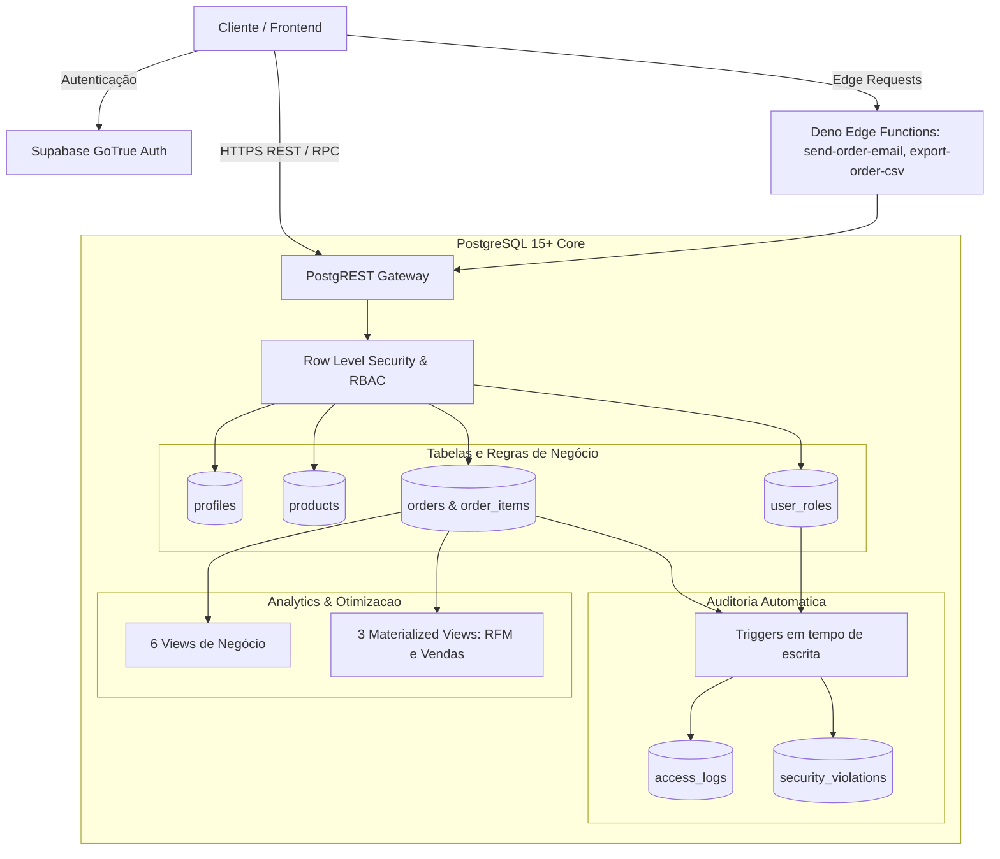

# E-commerce Backend - Supabase

[](https://github.com/devraphaeldiniz/ecommerce-supabase/actions)
[](https://www.postgresql.org)
[](https://supabase.com)
[](https://www.typescriptlang.org)
[](LICENSE)

Infraestrutura de backend e dados para e-commerce construída sobre PostgreSQL e Supabase. O projeto soluciona o desafio de segurança e governança de dados em sistemas multi-usuário diretamente na camada de banco de dados, utilizando Row Level Security (RLS) granular, RBAC em 4 níveis e triggers automáticos de auditoria.

---

## 🏗️ Arquitetura do Sistema



---

## ✨ Funcionalidades Principais

- **Segurança Nativa no Banco (RLS Granular):** Políticas de Row Level Security em 100% das tabelas, garantindo que usuários comuns acessem estritamente seus próprios pedidos e perfis, sem depender de validações manuais na camada de aplicação.
- **RBAC Hierárquico em 4 Níveis:** Papéis (`customer`, `staff`, `admin`, `super_admin`) mapeados na tabela `user_roles` e validados via funções PL/pgSQL.
- **Trilha de Auditoria em Tempo Real:** Registro automático de tentativas de acesso, modificações críticas e violações de segurança em `access_logs` e `security_violations`.
- **Analytics com Materialized Views:** Processamento pré-computado de métricas de vendas diárias e segmentação RFM (Recência, Frequência, Valor Monetário) para clientes.
- **Edge Functions Desacopladas:** Disparo de e-mails transacionais e geração de relatórios de pedidos em CSV via Deno runtime.
- **35+ Índices Estratégicos:** Cobertura de índices B-Tree e compostos para chaves estrangeiras, status de pedidos e filtros frequentes de catálogo.

---

## 🛠️ Stack Tecnológica & Decisões Técnicas

| Componente | Tecnologia | Decisão Técnica |
| :--- | :--- | :--- |
| **Banco de Dados** | PostgreSQL 15+ | Motor relacional robusto com suporte nativo a RLS, triggers procedurais em PL/pgSQL e materialized views com atualização concorrente. |
| **BaaS / Gateway** | Supabase (PostgREST + GoTrue) | Elimina boilerplate de CRUD gerando APIs REST seguras e tipadas diretamente a partir do esquema relacional com JWT nativo. |
| **Serverless** | Supabase Edge Functions (Deno) | Baixa latência e isolamento para tarefas assíncronas que requerem chamadas a serviços externos (envio de e-mails e exportação). |
| **Testes & Scripts** | TypeScript + Vitest | Validação automatizada de regras de integridade do banco e execução de suíte de testes de RLS. |

---

## 🚀 Como Rodar o Projeto

### Pré-requisitos
- Node.js 20+
- [Supabase CLI](https://supabase.com/docs/guides/local-development/cli/getting-started) ou conta ativa na nuvem Supabase

### 1. Clonar e instalar dependências
```bash
git clone https://github.com/devraphaeldiniz/ecommerce-supabase.git
cd ecommerce-supabase
npm install
```

### 2. Configurar variáveis de ambiente
Copie o template de ambiente:
```bash
cp .env.example .env
```
Preencha `.env` com a URL do seu projeto e suas chaves Supabase (`SUPABASE_URL`, `SUPABASE_ANON_KEY`, `SUPABASE_SERVICE_ROLE_KEY`). *Atenção: nunca compartilhe ou versione a service role key.*

### 3. Aplicar migrações ao banco
```bash
npm run db:push
```

### 4. Validar instalação
```bash
npm run validate:complete
```

---

## 🧪 Como Rodar os Testes

Execute a suíte com 27 testes automatizados de validação de esquema, RLS, permissões e integridade:
```bash
npm test
```

A suíte cobre:
- Setup e integridade estrutural do banco (12 testes)
- Resolução e consultas de Views e Materialized Views (7 testes)
- Regras de controle de acesso RBAC (2 testes)
- Triggers e logs de auditoria (2 testes)
- Desempenho e planos de execução (2 testes)
- Restrições de deleção via DELETE Policies (2 testes)

---

## 📊 Resultados e Métricas

- **Cobertura de Políticas de Segurança:** 100% das tabelas protegidas por RLS validado por suíte automatizada de testes.
- **Otimização de Consultas:** 35+ índices criados e validados contra *sequential table scans* em tabelas de alto volume.

---

## ⚠️ Limitações e Próximos Passos

- [ ] Medir o tempo de `REFRESH MATERIALIZED VIEW` com mais de 100.000 pedidos.
- [ ] Medir a latência p95/p99 das consultas autenticadas via PostgREST.
- [ ] Configurar job agendado (pg_cron) para atualização periódica das materialized views de analytics.
- [ ] Implementar política de expiração / retenção de dados históricos na tabela `access_logs`.
- [ ] Adicionar suporte a webhook para notificações de pagamento de gateways locais.

---

## 📄 Licença

Distribuído sob a licença MIT. Consulte [LICENSE](LICENSE) para mais detalhes.
